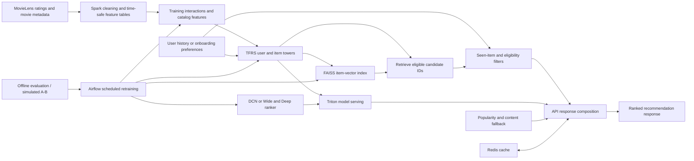

# Recommendation system architecture

## Goal

The assignment specifies a two-stage recommendation system: retrieve a few hundred eligible candidates, then score and order them for a user. The local service currently has a popularity default, explicit genre-based content fallback, and an optional sparse ItemKNN path. The experimental two-tower and DCN paths can be enabled in the native API, but their recorded development comparisons were below their respective baselines. The default Docker demo uses ItemKNN, genre and popularity fallbacks with optional Redis caching. Triton and Airflow have prototype code but have not been run in their real runtimes; the A/B API is a local prototype, not a real-user experiment.

## Target data and model flow

The diagram describes the target architecture, not fully deployed services. Pointwise and pairwise DCN scorers did not pass the development promotion gate. One pointwise scorer is available through an opt-in native API path for inspection, not enabled in Docker or the browser demo; reports are under `reports/development/`. The model, data, and application boundaries should remain independently testable: retrieval owns candidate coverage, ranking owns ordering within a supplied candidate set, and fallback covers users that provide no usable learned history.

## Request flow

1. Validate the request and obtain a user history or explicit onboarding preferences.
2. Remove items already seen and enforce catalog availability at the recommendation time.
3. For users represented by the retrieval model, score query and item vectors and retrieve a candidate pool from FAISS.
4. Re-score only those candidates with a time-safe DCN or Wide & Deep ranker. The current DCN class accepts user/item indices and numeric features and predicts explicit MovieLens ratings; it does not predict clicks.
5. Use popularity for a new user with no input preferences; use explicit genre preferences for a transparent content-based cold-start list.
6. Return ranked movie IDs with title/genre metadata and a clear strategy label.
7. Cache only when the cache key captures all ranking inputs, model version, catalog version, and history version.

The FastAPI service implements popularity, user-supplied genre matching, and optional ItemKNN scoring, with seen-item exclusion. The local HTML page exposes liked/highly-rated history IDs and preferred genres. Docker Compose loads the hash-checked ItemKNN development artifact. Its live HTTP and browser routes, the genre fallback, popularity fallback, and Redis health passed on 5 November 2026. The DCN and two-tower models have opt-in native API routes; their combined quality is unmeasured and they are not enabled in Docker or the browser UI. No live user-profile store exists.

## Current components and status

| Component | Current implementation | Status and evidence |
|---|---|---|
| Dataset | MovieLens 25M ratings and movie metadata already on the development machine | Used for offline temporal experiments; raw data is excluded from Git. See `docs/requirements-status.md`. |
| Time split and popularity | Global timestamp split; popularity from positive training ratings | Measured baseline in `reports/ml-25m/metrics.json`. The final 10% has a saved baseline evaluation and must not be used for tuning. |
| Two-tower retrieval | ID-only user/item towers, TFRS, exact inner-product FAISS | Experimental pilots and BPR comparator exist. The saved comparisons are below popularity; see `docs/bpr-objective-comparison.md` and `reports/development/`. |
| Local API and page | FastAPI `/`, `/health`, `/recommend`; `demo.html`; explicit genre matching; sparse ItemKNN; popularity fallback; Redis response cache | Docker Compose loads ItemKNN and Redis. Live `/health`, ItemKNN history recommendation, genre preference request, popularity fallback, and browser form passed on 5 November 2026. Redis is checked before ItemKNN scoring; a fixture regression test confirms a cache hit skips scoring. The saved ItemKNN validation panel was reused during development. Opt-in native DCN and two-tower routes are separate from the Docker demo. See `docs/api.md`. |
| Spark feature tables | `scripts/spark_prepare_features.py` writes time-bounded Parquet interaction, training-only user and popularity aggregates, and training-catalog genre tables. | The job and a synthetic 5-row test are present. A prior runtime smoke was reported in the work session, but no durable run log was found in the project; the current staging-folder cleanup change has not run in PySpark. The default uses the reused 60/70 development interval. Spark scans the CSV input to filter by time, but later rows do not enter outputs or aggregates. The full 25M run is NOT VERIFIED. This is data preparation, not a model or evaluation result. |
| Content-based cold-start | `/recommend` accepts `preferred_genres` and ranks by exact genre overlap | Implemented for user-specified preferences using the existing MovieLens catalog; tied candidates are ordered by training-period popularity. No new-user preference inference is claimed. Fixture tests and a live Docker Compose browser request passed. |
| DCN ranker | `scripts/dcn_ranker.py`, `scripts/train_candidate_dcn.py`, `scripts/train_pairwise_candidate_dcn.py` | Pointwise MSE and pairwise losses were tested on retrieved candidates. Both scored below ItemKNN order on the same 386 shared users and were not promoted; the pointwise model is available through an opt-in native API route. See the two candidate-ranker reports and `docs/ranking-model-protocol.md`. |
| Wide & Deep ranker | Not present | No second deep model will be added before the DCN path has a measured, time-safe comparison. |
| Redis | Optional Redis-py response cache through `NEXVIA_REDIS_URL` | Versioned keys include request inputs and artifact/catalog hashes; 300-second TTL; startup ping when configured; fail-open cache operations with health error reporting. Fake-client tests and an actual Redis-backed Docker Compose run passed; `/health` reported cache enabled without error. |
| Triton | Experimental Python-backend adapter and model configuration | Stub tests passed; real Triton startup, model loading and inference are NOT VERIFIED. See `docs/triton.md`. |
| Airflow | Manual-only DAG and retraining helper | Helper tests and syntax checks passed; execution in Airflow is NOT VERIFIED. See `docs/airflow.md`. |
| Online A/B and CTR | Opt-in local assignment, served-response and click-recording prototype | Synthetic checks passed; no real-user experiment or CTR result exists. See `docs/experiment.md`. |

## Saved two-stage compatibility check

The saved two-tower pilot has 108,155 user IDs and 12,224 item IDs. The saved pointwise candidate ranker has 2,000 user IDs and 6,100 item IDs; they share 1,951 users and 5,272 items. For those 1,951 users, an audit of raw FAISS top-100 lists found no list with all items in the ranker vocabulary; the median number known was 62. The strict ranker policy falls back if any item is unknown. The audit did not exclude user histories, so it cannot quantify fallback for actual filtered requests. The tower and ranker also originate from different development windows and candidate distributions. Together these results mean the current saved combination is not established as a useful end-to-end ranker. See `scripts/audit_two_stage_compatibility.py` and `reports/development/two-stage-vocabulary-compatibility.json` for artifact hashes and scope.

### Ranker training support correction

The saved ranker vocabulary includes candidate IDs even when no training label was observed for that ID. The hash-checked training export contains labels for 1,874 of 2,000 vocabulary users and 2,787 of 6,100 vocabulary items. The native inference adapter now requires the separately recorded training support and falls back for unsupported users or items. Earlier ranker and fallback-policy results used the previous vocabulary-only behavior; they are historical development results and do not measure this corrected policy. The ranker has not been retrained or shown to improve recommendations by this change. See `reports/development/ranker-training-support-audit.md`.

### FAISS-aligned ranker data feasibility

A seed-42 sample of 10,000 users from the saved retriever was chosen before examining their later ratings. In the reused 80/90 development period, splitting the interval at its time midpoint yielded 233 users with observed ratings in both halves. After retrieving up to 100 candidates per user and excluding earlier rated movies, only 756 early candidate ratings were observed; 57 users had observed candidate ratings in both halves. This is an exposure-biased support count, not ranking quality. The small overlap does not justify treating a ranker trained on this sample as reliably evaluated. Details and artifact hashes: `docs/faiss-ranker-feasibility-protocol.md`, `reports/development/faiss-ranker-feasibility-v1.json`, and `reports/development/faiss-candidate-label-support-v1.json`.

### FAISS-aligned feature DCN

A small feature-only DCN was trained on observed FAISS candidate ratings from the first half of the reused 80/90 development interval and evaluated on the second half. Its inputs are FAISS score and frozen training-period popularity rank; it has no trainable user or item IDs. It can be called through the opt-in native API with the matching retriever and hash-checked artifacts. A live HTTP check returned recommendations and an unknown-user fallback. It is not enabled in the default Docker demo; when configured natively, the experimental browser form exposes it. On the reused development cohort it improved NDCG@10 over FAISS order but did not clearly beat popularity order on the same candidates; absolute results were low. See `reports/development/faiss-aligned-ranker-result.md` and `docs/api.md`.

## Evaluation contract

- Use global time boundaries, keeping equal timestamps together. Never random-split interactions across time.
- Fit each model and its candidate catalog only on data available before its evaluation window.
- Report candidate-stage Recall@K and catalog coverage separately from final Recall@K and NDCG@K.
- Compare models on the same users, target interactions, candidate eligibility, and item catalog. Report warm/cold cohorts separately.
- Treat `rating >= 4` as a positive preference proxy. Unrated movies are not proven dislikes.
- Keep the final official 10% out of model selection. Existing 70/80 and earlier panels have already guided development and are not independent test sets.
- Do not call offline MovieLens ranking metrics accuracy, CTR, clinical outcomes, or online A/B results.

See `docs/experiment-protocol.md` for the data-split rules and `docs/bpr-objective-comparison.md` for the recorded candidate comparison and its limits.
